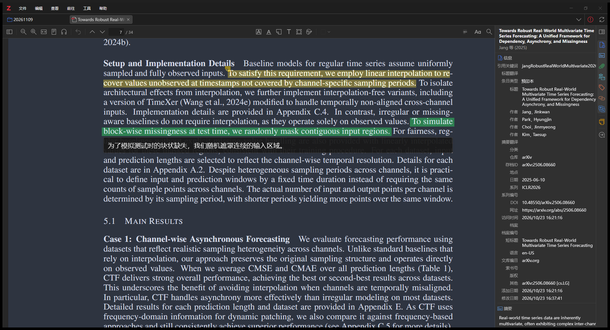

# Sentence Translate

在 Zotero 的 PDF 阅读器里点一个句子，就给该句加上按文字宽度的高亮，并在句子正下方显示中文译文；点下一句时，上一句的高亮和译文一起消失。

这是一个独立实现，不复用 Sentence Focus 的代码。句子切分、坐标换算、命中测试、高亮绘制和翻译都在本仓库内完成：插件自带翻译通道，只装这一个插件就能用，不需要再装其他翻译插件。



*真实截图（自定义深色配色）；默认浅灰配色会在句下显示浅灰译文条。*

## 依赖

- Zotero 10（仅在 Zotero 10.0.8 上开发与验证；7–9 与 11 未测试，故未声明支持）
- 不需要其他 Zotero 插件。翻译引擎内置，默认链路是 **大模型 → DeepL → Google → MyMemory**（大模型和 DeepL 只在填了对应 key 时参与），全部失败时才回退到已安装的 Translate for Zotero。
- 可选：如果本机已装 Translate for Zotero，可在引擎里显式选它，沿用其中配置的翻译服务；不装也不影响使用。

## 安装

从 [Releases](https://github.com/zrqworkmail-cloud/sentence-translate/releases/latest) 下载最新的 `.xpi`，然后：

1. 打开 Zotero → 工具 → 插件 → 齿轮 → Install Plugin From File…
2. 选择下载的 `sentence-translate-<version>.xpi`
3. 打开一篇 PDF，直接点句子即可

如果同时装着其他点句高亮插件，建议先禁用，避免两层高亮叠在一起。

## 更新

插件通过 `updates.json` 检查更新。已在干净配置实测 0.2.3 自动升级到 0.2.4，`latest/download/updates.json` 返回 0.2.4。

## 使用

- 单击句子：高亮该句，句下出现中文译文。
- 单击另一句：上一句的高亮与译文立即移除。
- 拖动选择文字、点击链接或注释：不触发。
- 缩放或翻页后高亮会清除，再点一次即可（译文有缓存，回来时立即显示）。

## 设置

编辑 → 设置 → Sentence Translate：

| 项 | 说明 |
|---|---|
| 启用点句翻译 | 总开关 |
| 配色方案 | 浅灰 / 纯白 / 深色 / 米色 / 浅蓝 / 高对比，一键套用 |
| 高亮颜色 | 系统取色器（任意颜色）+ 8 个常用色块 |
| 高亮不透明度 | 5–90，默认 38 |
| 译文背景色 | 系统取色器（任意颜色）+ 8 个常用色块，默认浅灰 `#e6e6e6` |
| 译文背景不透明度 | 0–100，默认 95 |
| 译文文字颜色 | 系统取色器 + 常用色块；默认“自动对比”，可手动指定 |
| 译文目标语言 | 默认简体中文 |
| 译文最多行数 | 1–6，默认 3 |
| 翻译引擎 | 自动 / 大模型 / DeepL / Google / MyMemory / Translate for Zotero，默认“自动” |
| DeepL API key | 可选，`…:fx` 结尾的 key 走免费端点 |
| 大模型接口地址 / 模型 / key | 可选，OpenAI 兼容的 `/chat/completions`，如 DeepSeek、通义千问、Ollama |
| 测试翻译 | 用固定例句实测当前引擎，直接显示引擎名和译文 |

引擎选择：“自动”按 **大模型 → DeepL → Google → MyMemory** 的顺序尝试，大模型和 DeepL 只在填了对应 key 时参与；全部失败后才用已安装的 Translate for Zotero。也可以手动锁定某一个引擎。

Google 引擎优先走 `clients5.google.com` 的扩展端点（共享代理出口下比 `translate_a/single` 的 gtx 接口更不容易被 429 限流），失败时再试 gtx 端点。

所有请求都经 Zotero 的 HTTP 栈发出，**跟随系统代理设置**；每个请求带硬超时（默认 12 秒，到时最多再等 2 秒），网络被墙或代理失效时会自动切到下一个引擎，不会一直转圈。key 以明文保存在 Zotero 首选项里，公用电脑上不要填。

配色方案会同时设置高亮色、高亮不透明度、译文背景色/不透明度和文字颜色；套用后仍可逐项微调。默认“浅灰”为 `#e6e6e6` / 95% / 自动文字；深色背景会自动改用浅色文字，也可以取消“自动对比”指定任意文字颜色。

## 实现要点

- 用 Zotero 10 的 `PDFViewerApplication.pdfDocument.getPageData({ pageIndex })` 取每页字符与 `viewBox`，不依赖阅读器内部选择状态，也不调用 Zotero 10 已不提供的 PDF.js `getPage().getTextContent()`。
- 字符矩形从 PDF 的左下原点换算成左上原点，再统一按页面百分比定位，缩放和滚动后仍能对齐。
- 文本项按基线聚成行，补回词间空格，识别双栏页面的中缝；按句末标点切句，跨行句子合并，行末连字符会接回。
- 高亮矩形按字符比例从文本项宽度切分，所以底纹贴合文字，而不是铺满整栏。
- 译文条宽度按原句从首字到末字的水平范围设置，与原文句子同宽；超过最大行数时在条内截断。

## 开发

```powershell
node test/text.test.js         # 纯文本几何层测试，不需要 Zotero
node test/translation.test.js  # 翻译层：分块、解析、回退链路，用注入的假通道
node test/live-providers.js    # 真实接口联调（需联网，可加 HTTPS_PROXY）
./build.ps1                    # 生成 build/sentence-translate-<version>.xpi
```

`src/lib/text.js` 和 `src/lib/translation.js` 都不引用 Zotero 或 DOM，可以直接在 Node 里跑；`src/bootstrap.js` 只负责阅读器接入、绘制和把 Zotero 的 XHR 注入翻译层。

## 已知限制

- 只支持 PDF；EPUB 和网页快照暂不支持。
- 句子切分是启发式的：参考文献条目、公式行和极端排版可能需要手动调整。
- 旋转页面、扫描件（无文字层）不保证可用。
- 译文是页面浮层，不写入 Zotero 注释。
- 免密钥的 Google 接口和 MyMemory 都是公开服务，可能限流或随时变更（共享代理出口更容易触发 Google 429）；对稳定性有要求时建议填自己的 DeepL 或大模型 key。

## 许可证

MIT，见 `LICENSE`。
