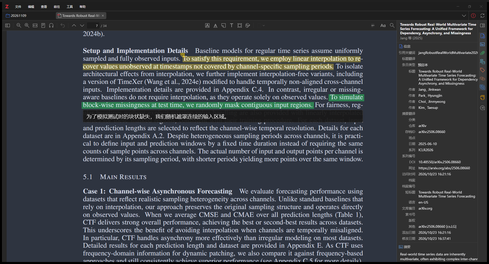

## 新增插件

- 仓库：https://github.com/zrqworkmail-cloud/sentence-translate
- 插件 ID：`sentence-translate@zrqworkmail-cloud.github.io`
- 最新版本：v0.3.1
- 许可证：MIT
- 兼容范围：Zotero 10（仅在 10.0.8 上验证）

*真实截图（自定义深色配色）；默认浅灰配色会在句下显示浅灰译文条。*

### 功能

点击 PDF 句子，在句下显示中文译文；点击下一句时清除上一处高亮与译文。译文条宽度与原文句子同宽，不再按译文长度向右扩展。翻译内置在插件里，只装本插件即可：「自动」按 大模型 → DeepL → Google → MyMemory 的顺序尝试（大模型和 DeepL 只在填了对应 key 时参与），全部失败才回退到已安装的 Translate for Zotero。Google 优先走 `clients5.google.com` 的扩展端点，失败再试 `translate_a/single`；请求经 Zotero 的 HTTP 栈发出、跟随系统代理，每个请求带硬超时，网络不通时自动换下一个引擎而不是一直转圈。免密钥接口用的是未公开端点，不保证长期可用。设置页新增“翻译引擎”区，可填 DeepL key、大模型地址/模型/key，并用“测试翻译”当场验证。

支持高亮颜色与不透明度、译文背景色与不透明度、译文文字颜色，以及浅灰、纯白、深色、米色、浅蓝、高对比 6 套预设；文字默认自动对比。

### 条目说明

- `discoverReleases: true`：最新正式版从 GitHub Release 读取，无需每次发版手动改清单。
- `releases: []`：暂不需要固定历史版本。
- `publishInShadow: true`：外部清单尚未收录时，审核合并后可在 shadow 模式发布。若维护者希望由审核流程添加此标记，请直接调整。
- 本地已用 TypeScript 6.0.3 对 `src/plugins.ts`、`src/types.ts` 做 `--noEmit` 校验，并通过 `git diff --check`。

关联投稿 issue：#367
